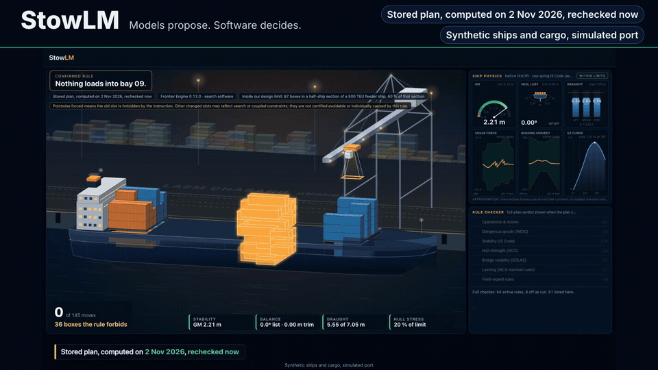

# StowLM

**The AI pipeline around a ship-planning engine, as an app. A planner says one sentence; the plan changes, and a checker passes it.**



Messy voyage documents and a planner's own words go in; a checked loading plan and a signed handover package come out.
Muse Spark reads the cargo papers, Muse Voice Transcribe hears the planner, and StowLM Reader (Muse Glimmer 30B,
fine-tuned by us with LoRA, schema-masked decoding, on the laptop) turns each instruction into a strict rule. The
planner confirms every reading, the engine plans, the full checker decides, and the rule-tier ladder names any rule a
relaxed plan breaks. Models propose; software decides.

**One slot for the engine.** Frontier Engine 0.13.0, our search software, is the reference engine in the slot. The
design lets a carrier, terminal or stowage-software vendor put its own planning software there and keep everything
around it. Only Engine 0.13.0 is wired into the app today; no third-party engine has been ported, so porting is the
design and the potential, not a tested integration (see [The engine slot](#the-engine-slot)).

Research pilot on synthetic ships and cargo at a simulated Laem Chabang-style port.

Watch a recorded run in your browser: https://amk-bot.github.io/StowLM/play/ (the Functional app's own screens on fresh
synthetic inputs we precomputed, not the film's call; no API calls and nothing to install; to change any input, install
the app).


| Meta model | Its job |
|---|---|
| **Muse Glimmer 30B**, fine-tuned by us (LoRA) as StowLM Reader, on device | Reads the planner's words into strict rules on the laptop. Locked test: 118 of 128 with our fine-tune, 60 of 128 without (same model, same laptop). It passed our 90 % gate and missed two stricter ones (one loosening accepted where none was allowed; 6 points below Muse Spark's 126 of 128, where 3 were allowed), so the planner confirms every reading. |
| **Muse Spark** (Meta Model API) | Reads the paperwork, finds where documents disagree, chooses the copilot's tools |
| **Muse Voice Transcribe** (Meta Model API) | Turns a simulated radio call into an editable transcript |

Plans come from Frontier Engine 0.13.0, our search software and the reference engine in the slot; the full checker (54 active rules) decides. Every planning result below was measured with Engine 0.13.0 in the slot.

**Held-out result:** 24 of 24 held-out test voyages inside the design limit (up to 195 boxes in a half-ship section of 500–800 TEU feeders) passed the full checker (exact 95 % interval 85.8–100 %); held-out maps, frozen pipeline, run after two interrupted attempts; not the pre-registered sealed claim. Two earlier attempts on the same maps stopped early when our own frozen-code guard tripped. In the first, a test rewrote a pinned fixture; in the second, the engine wrote scratch files inside its pinned folder. No planning code changed. They completed 36 and 91 rows; both are published as they are and not pooled with the final run. Where the same rows ran again in the final run, attempt 1 matched the final run on 36 of the 38 rows it opened (status and lifts; 37 of 38 on verdict alone) and attempt 2 on 91 of 91, reported separately.

The simple two-step planner, modelled from one field expert's description, passed 0 of 24 (0–14.2 %): 10 relaxed plans (L4 9, L5 1) and 14 with no plan; with 300 s it passed 1 of 24 (0.1–21.1 %). That says the baseline doesn't survive our rules, not that two-step planning fails in practice. With no mutual passes, no lift saving is quotable.

**Fresh held-out extension (ext-1).** Label: fresh held-out extension, run after the freeze; not the pre-registered sealed claim. 24 new maps inside the same design limit, from new seeds, pre-registered, run on pipeline v4 (planning code byte-identical to v3); reported beside the result above, not in place of it. On 24 fresh held-out maps, the pipeline returned a full-checker pass on all 24 (exact 95 %: 85.8–100 %); the simple two-step planner on 1 (0.1–21.1 %). With one instruction, 18 of 22 voyages whose first plan broke the rule got a checked plan that obeys it (59.7–94.8 %). Pooled with the first held-out run (secondary figure): 48 of 48 envelope maps passed the full checker (92.6–100 %); binding 31 of 40 (61.5–89.2 %). No lift saving is quotable (one mutual pass in the extension, too few to compare). Source: `experiments/mvp/pipeline/sealed/measurements/ext-1/FIGURES.json`; independent recount `experiments/review/v6/ext1-recount/final.json` and `comparison.json`.


**Install** (Apple Silicon macOS, Python 3.12, [uv](https://docs.astral.sh/uv/)):

```sh
uv sync --python 3.12 --locked
uv run python -m stowage.data_setup
uv run python -m app --v6
```

Then open the **Demo app** at <http://127.0.0.1:8000/planner?demo=1>.
For fresh synthetic inputs, start the **Functional app** with
`uv run python -m app --functional` and open
<http://127.0.0.1:8000/planner?live=1>. Details are under "Setup and run" below.

StowLM is a hackathon pilot of that pipeline, delivered as two apps on one planner
page. The **Demo app** replays the filmed call: a stored plan and recorded model
answers, with no key or model needed. The **Functional app** runs the pipeline now
on a fresh synthetic call: Muse Spark reads the call's papers (or yours), Muse Voice
Transcribe transcribes a spoken instruction, StowLM Reader reads it on the laptop,
you confirm the reading, Engine 0.13.0 plans, the full checker decides and a signed
package comes out. It runs on **your own Meta Model API key**; no key ships with
StowLM. In the Demo app, Muse Spark's copilot and summaries are recorded answers;
the Functional app's copilot isn't live yet.

The demonstration is designed for up to 195 boxes in a half-ship section of
500–800 TEU feeder ships, up to 70% fill, with an empty section on arrival and one
loading call. It includes small and tiny sections. The engine is not competitive
at large scale yet. A planner confirms each reading because the reader can
misinterpret an instruction. Relaxed plans name the rules they break and do not
count as full checker passes. Securing uses approximations and synthetic gear.

## The engine slot

StowLM is the pipeline around the engine. The paper intake, the instruction
readers, the planner's confirmation, the full checker, the rule-tier ladder, the
signed package and both apps are designed to stay the same whichever planning
software fills the slot. Frontier Engine 0.13.0 is the reference engine. **Only Engine 0.13.0 is wired
into the app; no third-party engine has been ported.** Porting is the design and
the potential, not a tested integration.

What the slot is today, checked in the code:

- **One call.** The runner reaches the engine in one place: `engine_call` in
  `experiments/mvp/pipeline/runner/core.py` calls the binding's
  `execute_brief(instance, receipt, …)`. The binding
  (`experiments/mvp/pipeline/binding/`, core in `adapter.py`) verifies the
  planner's confirmation, rebuilds the confirmed readings and calls
  `plan_with_rules(instance, answers, …)` with them as validated reader-schema rules.
- **One plan format.** A plan comes back as a `PlannerResult` holding a `MovePlan`
  (`src/stowage/model`). The runner then checks that plan itself before anything is
  drawn or packaged: the full checker on the original instance, a recheck of every
  confirmed instruction, and the ladder's classification from the checker's report.
  The engine's own verdict doesn't release a plan.
- **One pin.** The binding verifies the engine's source manifest
  (`experiments/mvp/frontier/engine/source-manifest-0.13.0-review-fixes.json`)
  before, during and after each call and withholds the plan if the pinned source
  changed. The signed receipt records the engine version and manifest hash.

Evidence that another planner can sit behind the same gate: in the held-out
evaluation, the simple two-step baseline (`stowage.solver.twostep`) returned plans
in the same `MovePlan` format, and the evaluation worker
(`experiments/mvp/pipeline/sealed/worker.py`) put both planners' plans through the
same full checker and tier classification (the two-step planner passed 0 of 24 in
the first held-out run and 1 of 24 in the extension; labels and the interrupted-run
account are with the results above). That ran in the evaluation harness, not through
the app's slot.

What a port would take: planning software that takes the instance and the
confirmed rules and returns a `PlannerResult` for the same instance and call
through those two functions, plus its own source-manifest pin in place of
Engine 0.13.0's. Two parts are specific to Engine 0.13.0 today: the binding applies
the confirmed rules by scoping the engine's internal tables
(`experiments/mvp/pipeline/binding/hooks.py`), and relaxed plans come from the
engine's own tier search. A ported engine would honour the compiled rules itself
(each one reports forbidden box–slot pairs and a plan's violations) and could offer
relaxed plans of its own; the runner's recheck and ladder still decide. A port
changes pinned pipeline code, so it would be a new frozen pipeline, and every
figure in this README belongs to Engine 0.13.0, not to a ported engine.

## Hackathon work

**Hackathon work (26 October–4 November 2026).** StowLM was started on 26 October 2026 for the Meta Global AI Developer Hackathon. The application, planning/checking code, AI pipeline, fine-tuning work, synthetic demo fixtures and evaluation artifacts in this submission were built during that event window. Pre-existing dependencies, public reference sources and Meta base models are credited separately and are not claimed as original work. Model weights and LoRA adapters are distributed separately; adapter download links and their licences are listed below. Demo ships, cargo, documents, pictures and voices are synthetic; no company or customer data is included.

## Setup and run

The current local-model path targets Apple Silicon macOS with Python 3.12 and
[uv](https://docs.astral.sh/uv/). Other platforms are not claimed as tested.
From the repository root:

```sh
uv sync --python 3.12 --locked
uv run python -m stowage.data_setup
uv run python -m app --v6
```

The data step downloads the public NMRI KCS hull archive and checks its pinned
SHA256; the archive is not redistributed. Without this data, every full check
reads **NOT VALIDATED**. For an offline installation, use
`uv run python -m stowage.data_setup --archive /path/to/kcs_offsets.ZIP`.

Open the [Demo app](http://127.0.0.1:8000/planner?demo=1), the take-4 planner.
Keep `--v6` in the launch command; it selects the stored demonstration.
Do not combine it with older explicit instance/run-folder selections.
The retired v6 stage (`/stage?v6=1`) still loads for the record; it is not the product.

The locked dependency file and selected playback dependencies are included.
Stored plans and recorded model answers use the supplied
fixtures; they do not imply a new model call. Live reading needs the base model
and published reader adapter installed as described in Live StowLM Reader below. Live
cloud tools additionally need your own Meta Model API key, set up as described under
Functional app below; never put a key in a command argument, committed file or recording. A clean offline
replay and fresh installation pass (3 Nov 2026, D336: networked install, data step and
app/tests plus static_play in one session in a fresh copy; see the table below). Live reading wasn't run in the
fresh copy because it needs the separately published adapter.

### Functional app: fresh synthetic inputs

```sh
uv run python -m app --functional
```

Open <http://127.0.0.1:8000/planner?live=1>. Add `--v6` to serve both apps
from one server; `/functional` redirects to the live planner. The Functional app
starts without model weights or a key and reports unavailable stages with setup
instructions. `GET /api/functional/status` checks availability without loading a
model or making a cloud call.

Enter **your own Meta Model API key** in the planner's API key panel and explicitly
accept paid calls with a cap you choose. The key stays in server memory for that
launch unless you choose to save it. Alternatively, copy `.env.example` to a
private repo-root `.env` and fill its values locally; `--env-file PATH` selects a
different file. Process environment values take precedence. Paid calls also
require `STOWLM_ACCEPT_PAID_CALLS=1` (or `SPARK_CREDIT_READY=1`) in that file or
environment, or consent in the app. Set `STOWLM_FUNCTIONAL_CAP_USD` to your chosen
launch cap (default $10 a launch); inspect the displayed cap before consenting. Spark intake and Voice
use the Functional app's local spend ledger. Keys, calls, caches and spend
records are excluded from the public export.

For the StowLM Reader, install the separately distributed Glimmer base and
adopted adapter using the instructions below, then launch:

```sh
uv run python -m app --functional --reader-adapter models/stowlm-reader
```

Live reading requires Apple silicon, MLX, `models/glimmer-30b-4bit/` and the
adapter; no key is required for that local model stage. The base and adapter are
not included in the code export. Without them, explicitly choose **Plan with no
instruction**. Without a cloud key, explicitly choose **Use the generated load
list, not read by a model**. Those choices skip the named model stages; nothing
is replayed in their place. A full checker and signed package still require the
hull data installed above. Stress test and Ask copilot are not live yet.

All inputs remain synthetic ships and cargo at a simulated port. Only L0 is a
full-checker pass; relaxed plans name their level, broken rules and boxes ashore.
See [Functional developer notes](experiments/mvp/ui/functional/README.md) for
routes, file shapes and limitations. A fresh-copy smoke check establishes setup
and unavailable-stage behavior, not live end-to-end model success. Live end-to-end
runs on 3 Nov 2026 (the developer's laptop and key; fresh seeds) are recorded in
[the verification notes](experiments/mvp/ui/functional/verification/VERIFICATION.md):
two fresh calls passed the full checker, one with a spoken instruction read by the
StowLM Reader; medium calls with an instruction did not pass within the deadline in
two tries, and two small calls met instructions their sections couldn't hold.

<!-- BEGIN READER SETUP -->
### Live StowLM Reader on Apple silicon

The live reader runs in the Functional app, in the locked Python 3.12 environment. Accept the base model's applicable access and usage terms separately. The conversion recipe below is recorded; a fresh model conversion and live inference were not run in the fresh-copy check.

```sh
uv sync --python 3.12 --locked
uv run python -m stowage.data_setup
uv run python experiments/glimmer-bench/convert.py models/glimmer-30b-4bit 4
```

The existing converter fetches `meta-models/Muse-Glimmer-30B` revision `cec94fcfd6512f2cfe708138c32533b346ea4f69` and applies the recorded text-only sanitizer plus affine 4-bit, group-64 MLX quantization. The historical base has no conversion receipt; rerunning this documented recipe is not a demonstrated byte-identical reproduction. The hull data step is for the full checker, not adapter inference. For an offline hull archive use `uv run python -m stowage.data_setup --archive /path/to/kcs_offsets.ZIP`.

Download the separately published adapter with the locked Hub SDK's `snapshot_download` API:

```sh
uv run python - <<'PY'
from huggingface_hub import snapshot_download
snapshot_download(
    repo_id="A-M-K/stowlm-reader-v3",
    revision="74c7931ecefb43f824b4a6c9395f25a3558a55d0",
    local_dir="models/stowlm-reader",
    allow_patterns=["adapters.safetensors", "adapter_config.json", "STOPPED.json",
                    "README.md", "NOTICE", "LICENSE", "PROVENANCE.md", "SHA256SUMS", "upstream/*"],
)
PY
(cd models/stowlm-reader && shasum -a 256 -c SHA256SUMS)
```

The adapter tensor SHA256 must additionally equal `eff712e18a649804fcbd5b19db27baa709fa60701a2970d1fa58593f731c6f57`. SHA256SUMS verifies the selected published files; it is not a trusted signature. The Hub's local `.cache/` metadata is not part of the upload bundle.

```sh
uv run python -m app --functional --reader-adapter models/stowlm-reader
```

Open `/planner?live=1` on the printed local URL. Create a call, then in **3 · Instructions** type a sentence (or record or upload a WAV for Muse Voice Transcribe, which needs your API key), choose **Read with StowLM Reader**, review the reading and confirm it before you plan. The app passes the chosen adapter to `GlimmerParser`, loads the base lazily from `models/glimmer-30b-4bit/` at the first reading, and uses the same v3 masked decoder as evaluation. The reader itself needs no API key. It does not fall back to Muse Spark: without the base or adapter the reader stage shows "unavailable" and why, and you can choose to plan with no instruction. Confirmation records what was confirmed; it does not authenticate who confirmed. The historical absolute `model` entry in the byte-identical adapter config is ignored by the MLX adapter loader: the app supplies the base path explicitly.
<!-- END READER SETUP -->

## Separately published model artifacts

Weights and adapters are distributed separately on Hugging Face.

| Artifact | Download / licence / provenance |
| --- | --- |
| Meta Muse Glimmer 30B base | [Upstream model](https://huggingface.co/meta-models/Muse-Glimmer-30B); use its applicable licence and notices |
| Adopted StowLM Reader LoRA | <https://huggingface.co/A-M-K/stowlm-reader-v3> |
| Reader adapter NOTICE, training provenance and checksums | <https://huggingface.co/A-M-K/stowlm-reader-v3/tree/74c7931ecefb43f824b4a6c9395f25a3558a55d0> |

The private-intake fine-tune did not beat its untrained baseline and is not the
shipped intake; no shipped privacy feature is claimed.

The adapter was trained partly on 1,228 Muse Spark paraphrases. We read the Meta
Model API Terms of Service (last updated 9 October 2026) before publishing: §4.1
says the customer owns Outputs, and §10.1(ix) bars using Outputs to train a model or
product "that competes with Meta's models or services" without Meta's written
authorization, without defining "competes". The reader is a LoRA adapter for Meta's
own Muse Glimmer for one narrow task, and we read it as not competing (D363).

## Who benefits

Potential, labelled as potential (D254).

- **The ship planner at a Laem Chabang feeder operator:** says a limit in their own words, confirms how it was read, and gets a checked plan; a plan that fails says which rules it breaks. Fewer restows is the aim, not a result yet: no lift saving is quotable today.
- **The terminal:** fewer extra lifts and shorter berth time are the potential, labelled as potential. Worldwide, the mid-case pool is about $7 billion a year of extra crane work and berth time (projection; low $1.2 billion), inside about $90 billion a year of port-call cost; about $125 million a year at Laem Chabang if scaled by its share of calls (projection).

    > Projection. Inputs: 920M TEU, 520k calls, assumed 10 % restows at $75 a lift, 5 % less berth time. What would have to be true: full-ship, multi-port planning works; these rates hold worldwide; the extra work is avoidable; operational use needs terms that permit it (D316), plus class approval; none of it has been measured. Check: world terminal revenue is $63–76 billion a year.

- **Carriers, terminals and stowage-software vendors with their own planning engine:** the potential is to keep that engine in the slot and add the pipeline around it: papers read, instructions taken in the planner's own words and confirmed, every plan gated by the full checker, a signed handover. Potential only: no third-party engine has been ported or tested.
- **The shipper:** on-time departures, if fewer lifts shorten berth time; that isn't verified.
- **Thai freight forwarders:** messy bookings and tally sheets become a load list, with doubts raised as questions instead of guesses (development: Spark read 70.79 % of fields against 36.03 % for a parser with no model).

## Path to real use

1. **Validate the reader on real planners' sentences.** Needs: 10–20 instructions from working planners, including Thai-English, frozen and scored once (task 0.8). Today: 118 of 128 on a locked test whose sentences a separate AI reviewer wrote, not real planners.
2. **A BAPLIE 3.1.1 exporter.** Needs: the full SMDG 3.1.1 guide and code lists, a synthetic interchange profile, a documented slot conversion, dangerous-goods, reefer and out-of-gauge handling, and independent parse and round-trip validation. Today: the package exports `plan.json` and `crane-sequence.csv`; BAPLIE was cut because a validated exporter wasn't established (`experiments/mvp/pipeline/package/BAPLIE.md`).
3. **A pilot with a Thai feeder operator on its own data.** Needs: the operator's yard data, real tariffs and real planners' phrasing. Today: synthetic ships and cargo, simulated port; 24 of 24 held-out test voyages inside the design limit passed the full checker (held-out maps, frozen pipeline, run after two interrupted attempts; not the pre-registered sealed claim; third attempt; two earlier runs stopped on our own guard, both published; see the interrupted-run account above).
4. **A firm's own engine in the slot.** Needs: the firm's planning software behind the binding's two functions (instance and confirmed rules in, a `PlannerResult` out), its own source-manifest pin, its own way to honour the compiled rules, a new frozen pipeline and a fresh held-out run through the same checker. Today: only Engine 0.13.0 is wired into the app; the two-step baseline went through the same checker in the evaluation harness, not through the slot (see [The engine slot](#the-engine-slot)).
5. **Terms that permit operational use (D316, D363).** Needs: Meta's permission, or a base model and API terms that allow it. Today: a research demonstration. The Muse Glimmer usage policy (§2.4) prohibits use related to operating transportation technologies where harm is possible; the Meta Model API Acceptable Use Policy lists the same and bars relying on Outputs for safety decisions "without a qualified person reviewing the Outputs". The planner's confirmation and the checker gate are the pipeline's human-review design, not a permission.
6. **Class approval.** Needs: a class society's review, vessel-specific stability data and a real Cargo Securing Manual. Today: a full checker with 54 active rules; lashing is our approximation with synthetic gear.
7. **A larger model and more compute for full ships and multiple ports.** Needs: engine work at that load, multi-port planning and a wider reader. Today: up to 195 boxes in a half-ship section of 500–800 TEU feeders, one loading call; the engine isn't competitive at large scale yet.

## Validation and limitations

Research demonstration on synthetic data. The base model's usage policy and the Meta Model API Acceptable Use Policy prohibit use related to operating transportation technologies where harm is possible, so this must not be used to plan or operate real vessels; an operational version, by us or by a firm with its own engine in the slot, would need terms that permit it.

On 100 synthetic instructions written after the freeze by a different model (not real planner text; not sealed; one pre-registered run on the same ships and four kinds of rule), the adopted StowLM Reader read 86 exactly (95 % interval 77.6–92.1 %). The same model and mask without our fine-tune read 45 (35.0–55.3 %), and a hand-written parser 68 (57.9–77.0 %). On the 66 sentences that carry a rule, it read 61 exactly (83.2–97.5 %), against 18 untrained (17.0–39.6 %) and 44 for the parser; its 5 misses were refusals, never a different rule. Its weak side is refusing. Of 34 sentences it should have refused, it turned 6 into a rule (6.8–34.5 %), more than the untrained model's 2 or the parser's 1, though the intervals overlap. One dropped half an order ("Close bays 9 and 11" read as bay 9 only) and one invented a number ("Max 4 tiers in the hold of bay 9" read as 2). That's why every reading is shown to a person and confirmed before anything is planned. It read 4 of the 5 Thai-English sentences. Source: `experiments/mvp/reader/v3/ood-1/REPORT.md`. The author and the blind second labeller are both Claude models, so their agreement can share blind spots.

The completed planning report is at
`experiments/mvp/pipeline/sealed/runs/final-3/REPORT.md`, with the figures in
`story-figures.json`. Its label is **held-out maps, frozen pipeline, run after two
interrupted attempts; not the pre-registered sealed claim**; see the interrupted-run account beside the result above. Both interrupted
attempts' READMEs and all three attempts' original rows are retained; rows use
lossless gzip and XZ archives. `EXPORT-NOTES.md` explains
reconstruction and gives the raw hashes. There is no quotable lift-saving result. The package records what confirmed each reading; it doesn't authenticate the confirmer. Pinning a trusted runner key is future work (D312). For the first hour of the final run, two freeze test suites, one triage suite and one draining lattice row ran beside it (D278); wall times are upper bounds. The launcher's 'other fleet work stopped' message was wrong for that hour.

The film build has a plain hash inventory at
`experiments/mvp/video/film-inventory-20261103-final.json` (D335), rather than a strict
film-layer launch guard. The claim is one hashed pipeline. 3.1 was measured on frozen pipeline v3 (a11b4202…). The demo and handover package run on v4 (acf2f275…), which changes only the package and freeze code; engine, reader, checker, binding and runner are byte-identical (manifest diff published). Historical manifests
are retained unchanged, including film-inventory-20261102.json and film-inventory-20261102-v4.json as history; a curated public subset omits model weights and sealed
inputs and cannot pass the original full-tree freeze check unchanged.

Paths inside signed bundles are kept as signed; changing them would break their signatures. mlx-vlm and opencv-python are installed for a feature that was cut.

Repo and pipeline counts below are the 2 November 2026 frozen-v4 runs (D314; logs and JUnit XML in `experiments/mvp/pipeline/freeze/suites/v4/`); no src or pipeline code changed since. The app and static-playback tests ran together on 3 November 2026: development tree at 02:10 EST (p22), fresh copy at 02:21 EST (D336).

| Measurement | Final evidence |
| --- | --- |
| Repo tests (`tests/`) | 14,585 passed; 5 failed; 80 skipped (33 min). The 5 failures are 4 legacy-report geometry-lineage checks outside the pipeline and 1 source-file ownership gap; same count as the earlier frozen-source run (D283) |
| Pipeline tests (`experiments/mvp/pipeline/`) | 4,007 passed; 3 failed; 2 errors. 3 are stale fixtures inside pinned test files (two hero-recording setups expect the hero before bay 9; one stale hash); 2 are spawn-worker tests that pass when run alone and fail inside the full run (test interaction) |
| App and static playback tests (`app/tests/` plus `experiments/mvp/ui/static_play`), development tree, one session | 1,605 passed; 0 failed (p22, 3 Nov 2026, 02:10 EST) |
| App and static playback tests, fresh copy, same two folders in one session | 1,534 passed; 0 failed; 71 skipped (D336, 3 Nov 2026, 02:21 EST): 11 dev-only historical artefacts, 1 withheld stock-TTS clip, and 59 v5-era features the v6 demo doesn't use; no v6 feature skips |
| Commands, environment and date | macOS 26 on Apple M5 Max, Python 3.12 via uv. Repo/pipeline, 2 Nov 2026: `uv run pytest` (repo); `PYTHONPATH=src:experiments/mvp/frontier:experiments/mvp/frontier/lab uv run pytest experiments/mvp/pipeline`. Development and fresh-copy app/static-playback, 3 Nov 2026: `PYTHONPATH=.:src:experiments/mvp/frontier:experiments/mvp/frontier/lab uv run pytest app/tests experiments/mvp/ui/static_play` |
| Fresh-copy setup and v6 playback | Export of commit-list-final.md, 7,794 files (590.2 MB), to an empty folder (D336, 3 Nov 2026, 02:21 EST), then `uv sync --python 3.12 --locked` with network, `uv run python -m stowage.data_setup`, `uv run python -m app --v6 --help` and a 3-test smoke: all pass; then both test folders in one session as above |
| Held-out planning report (with both interrupted runs), sealed reader report, comparison reports | `experiments/mvp/pipeline/sealed/runs/final-3/REPORT.md` and `story-figures.json` (label above; measured on v3), archives `runs/interrupted-1/` and `runs/interrupted-2/`; independent recount `experiments/review/v6/code11.md`; reader report `experiments/mvp/reader/v3/results-final/final-adoption-d266.json` (adopted reader, 118 of 128 sealed sentences; D266) |

Results describe synthetic experiments inside the stated envelope, with
Engine 0.13.0 in the slot. They do not establish operational readiness, class
approval, performance against commercial planners or how another engine would do in
the slot. Projected benefits must retain their assumptions and projection labels.

## Project notes

The `docs/` folder holds the working notes the project was built on:

- [`docs/headline.md`](docs/headline.md): the claims contract. Every number and
  label in this repo follows its wording rules.
- [`docs/evaluation.md`](docs/evaluation.md): metrics, baselines and every results
  table, each with its label.
- [`docs/rule-tiers.md`](docs/rule-tiers.md): the five rule tiers, and how
  enforcement peels back when no plan is found.
- [`docs/domain.md`](docs/domain.md): a stowage, dangerous-goods and yard primer,
  the field expert's rules and the constraint catalogue.
- [`docs/data-sources.md`](docs/data-sources.md): the public sources, their
  licences, and what is synthesised instead.
- [`docs/frontier.md`](docs/frontier.md): related research and industry tools.
- [`docs/impact.md`](docs/impact.md): the low, mid and high impact estimate, with
  its inputs and caveats.

The notes cite decision ids (D…) and plan task ids from the project's decision
log and plan, which are not published. Some cite working files that are not in
this repo; those are marked where they appear.

## Synthetic data and recorded outputs

**Synthetic ships and cargo, simulated port.** Demo documents, pictures and voices
must carry their synthetic/generated labels. Replayed model output says
“Recorded answer”; stored plans carry their computation date and recheck label.
No real company or customer data is included. Public source facts are references,
not copies of a real vessel's operational stowage.

Radio clips' audio is not included because no redistribution licence is
available. The radio chapter shows the transcript instead.

## Credits and licensing

Meta's base models and APIs, third-party Python dependencies, public ship and
regulatory references, and published research predate this project and are
credited in `NOTICE`. See `uv.lock` for dependency versions. Actual redistributed
source extracts need their own attribution and applicable licences; the code
licence cannot relicense them.

Pre-existing Meta models and services: Muse Glimmer 30B, Muse Spark and Muse Voice Transcribe; brag (MIT); HyperFrames (Apache-2.0); Sascha Ende (CC BY 4.0); CC0 SFX provenance from Kenney and OpenGameArt; KCS hull data downloaded, not redistributed; UN/LOCODE (CC BY 4.0).

The project source is licensed under Apache-2.0. Copyright 2026 AMK-bot.
See [LICENSE](LICENSE). The StowLM Reader adapter is published separately under Apache-2.0, with its own NOTICE and provenance (D327). The base model's licence and usage policy remain applicable. Google Translate-generated radio audio is withheld; transcripts are shown.
